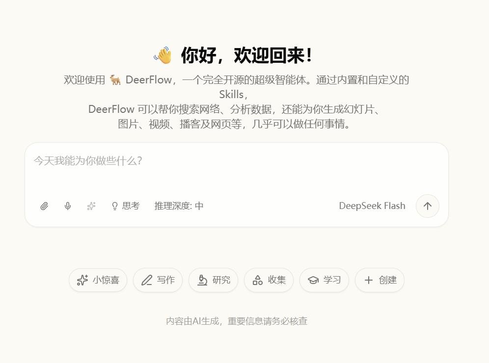
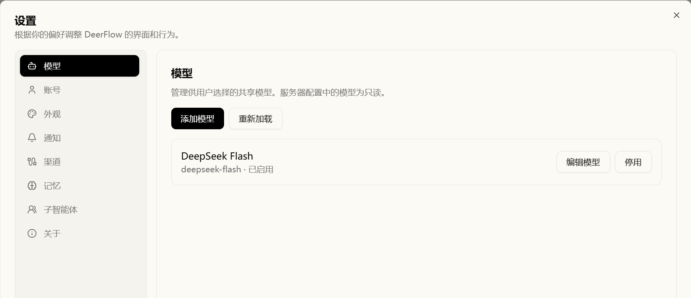
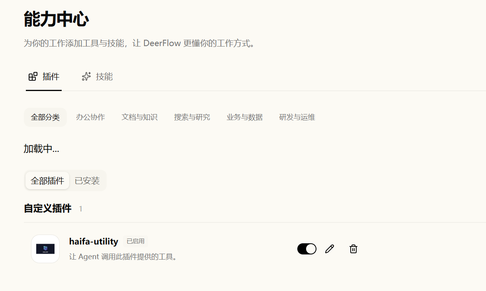

# Haifa Super Harness

Haifa Super Harness 是一个可在本地部署的 AI 助手工作台，帮助你通过对话完成资料检索、文件处理和多步骤任务。
你可以选择模型、启用技能与外部工具，让助手执行任务或委派给子智能体，并在同一界面查看执行进展、审批操作和下载成果。

本项目复用 DeerFlow 的界面与交互方式，由 [Haifa Agent SDK](https://github.com/haifa-agent/haifa-agent) 驱动任务执行，持续完善工具、技能与任务协作体验。

> [DeerFlow](https://github.com/bytedance/deer-flow) 是由字节跳动开发并开源的 AI 智能体框架，通过协同子智能体、工具与技能完成研究、编程和内容创作等复杂任务。

<table>
  <tr>
    <td width="33%"><a href="assets/images/welcome.png"></a></td>
    <td width="33%"><a href="assets/images/setting.png"></a></td>
    <td width="33%"><a href="assets/images/capability.png"></a></td>
  </tr>
</table>

## 架构边界

本仓库是独立的 Java 21 产品工程，仅通过 Maven 仓库中已发布的
`io.haifa:haifa-agent-bom:0.1.4-SNAPSHOT` 及公开 JAR 消费 Haifa Agent，不依赖其源码目录。
DeerFlow 固定为 `bytedance/deer-flow@e545c28ac301e6f9feae247c513d8ea8f83df294`，不随 `main` 漂移；
项目直接复用该版本前端，以 Haifa Agent 作为唯一 Agent Runtime，兼容其真实 REST/SSE/WS/文件/auth 协议。

Super Harness 是产品、兼容与集成层，不是第二套 Agent Runtime。可复用的 Runtime 能力（Run/Loop、
Memory、Tool/Skill、MCP、Sandbox、Approval、Artifact、Checkpoint、Parent/Child 等）归 Haifa Agent；
Super Harness 负责冻结 DeerFlow 协议映射、产品语义、UI/BFF、业务集成与控制面展示。新增基础能力前须按
[Runtime / Product Boundary](docs/runtime-product-boundary.md) 做归属判断；如果缺的是通用 Runtime 能力，
应先补 Haifa Agent 公开 API/SPI，再由本项目消费。

## 模块

- `super-harness-app`：最小应用基础，验证公开 SDK 的 `Run → Java 类型化 Tool → Artifact` 链路。
- `super-harness-events`：事件投影核心，把 SDK Run 事件投影为冻结 UI 可消费的兼容事件。
- `super-harness-workspace`：受限工作区与文件快照，承载 Run 变更的发布与恢复。
- `super-harness-server`：DeerFlow 兼容网关，承载 HTTP/REST/SSE/WS 协议、BFF 目标与全部产品能力。
- `super-harness-harness`：最小化、失败即关闭的证据校验器；必需用例缺失、显式失败或标为 PASS 却无证据时校验失败。

## 能力概貌

- **协议与界面**：复用冻结 DeerFlow 前端，提供 REST/SSE/WS、文件与身份兼容接口。
- **对话与委托**：支持 Agent 身份与 SOUL、子智能体委托、模型与思考配置、流式输出及运行诊断。
- **工具与扩展**：接入文件、Web、Skill 和 MCP；宿主 Shell 与技能脚本工具默认关闭，启用后须审批。
- **成果与恢复**：通过 Haifa Agent 承载审批、Artifact、持久化与重连恢复。

能力配置、限制与已知差异见[开发与运行手册](docs/development-manual.md#能力配置与限制)。

## 目录结构

- `super-harness-*/`：Java 模块，见上。
- `scripts/`：常用入口 `test-targeted.ps1`、`verify-full.ps1`、`start-main-super-harness.ps1`，其余按前端、
  协议、资源、doctor、UI、MCP、证据与治理分类，共用函数在 `scripts/lib/`。完整说明见
  [scripts/README.md](scripts/README.md)。
- `tests/`：`tests/checks/` 保存脚本与校验器回归，`tests/ui/` 按 `smoke/`、`files/`、`dual-backend/`
  保存浏览器用例与夹具；Java 测试在各模块 `src/test/java/`。说明见 [tests/README.md](tests/README.md)。
- `docs/`：稳定的开发与使用手册。
- `dist-support/`：对外发布包基础设施（`scripts/`、`templates/`，以及不入库的 `outputs/`、`releases/`），
  说明见 [dist-support/README.md](dist-support/README.md)。
- `contracts/`、`third-party/`、`resources/`、`frontend/`、`deer-flow/`：冻结协议、资源、前端与来源校验。
- `private-docs/`：提示词、roadmap、评审与交付报告，正文不在本 README 展开。

旧 worktree 分支与 `main` 历史不连通时，可用
`python scripts/governance/audit_disconnected_branches.py` 批量核对内容：先验证新旧主线的完整文件树桥接，
再检查祖先关系、精确文件变更和内容/模式，输出已确认项与待核对差异。脚本只读 Git，不调用模型或删除分支；
参数、判定边界和复现命令见 [脚本目录的治理说明](scripts/README.md#governance--shpm-治理与门禁建议)。

## 构建与验证

使用 Java 21、Maven 3.9.15 和 PowerShell 7，也可使用仓库 Maven Wrapper（首次需下载分发包）。
全仓门禁入口为 `pwsh -NoProfile -File scripts/verify-full.ps1`，脚本回归入口为 `pwsh -NoProfile -File scripts/verify-scripts.ps1`。
门禁先执行预检，再按 Java 输入指纹复用已有结果或运行离线构建，摘要保存在 `local-tmp/verify-full/`。
详细命令、构建缓存、资源选择与证据复用规则见[开发与运行手册](docs/development-manual.md#构建与验证)。

## 发布包（dist-support）

对外下载的单前缀发布包与安装/服务化基础设施位于 `dist-support/`：`package-release.py` 生成
`releases/super-harness-<version>.tar.gz`（含预构建 JAR、冻结资源与前端产物），包内
`scripts/install-service.py` 把应用注册为 Linux systemd 或 Windows WinSW 服务。
命令、目录布局、密钥/数据约定与已知边界见 [dist-support/README.md](dist-support/README.md)。

## 定向测试与 SDK 版本选择

定向测试使用 `pwsh -NoProfile -File scripts/test-targeted.ps1 -Test <测试类>`，可加 `-Module`、`-LowMemory` 或 `-Slow`，匹配 0 个测试算失败。
测试日志保存在 `local-tmp/test-targeted/`，入口输出 JSON 汇总，默认跳过标注为 `slow` 的用例。
`main` 只消费 `0.1.4-SNAPSHOT`，工作包候选 SDK 由主控通过该 worktree 的 `local-tmp/sdk-selection.json` 指定，执行者不得自行换版或直接传 `-Dhaifa.version`。
测试示例、SDK 摘要、基线检查与交付辅助命令见[开发与运行手册](docs/development-manual.md#定向测试与-sdk-版本选择)。

## 冻结前端本地准备与启动

每个验收 worktree 使用独立的 `frontend/node_modules`、`.next`、端口和数据目录；冻结来源按固定 DeerFlow
提交校验。先确认 Corepack pnpm 版本精确为 `10.26.2`，再离线安装：

```powershell
$env:COREPACK_ENABLE_NETWORK='0'
corepack pnpm --version
corepack pnpm install --offline --frozen-lockfile
```

安装输出须为 `downloaded 0`。以下命令只校验冻结前端、已记录的最小 BFF 补丁、仅连接 Haifa 的 loopback
配置与固定 Node/pnpm 工具链，不启动服务：

```powershell
pwsh -NoProfile -File scripts/frontend/start-haifa-frontend.ps1 `
  -DryRun -SourceRepository D:\workspace\haifa-agent-super-harness\deer-flow
pwsh -NoProfile -File tests/checks/frontend/verify-haifa-frontend-profile.ps1
```

不带 `-DryRun` 正式启动时，脚本会在前端就绪后自动后台预热工作区路由（`/`、`/workspace` 及 `chats`、`agents`、`scheduled-tasks`、`capabilities`、`trash`），把 Next.js 首次动态渲染的冷启动成本从用户首次点击移到启动阶段；日志写入 `<DataDirectory>/logs/frontend-warmup-*.log`，可用 `-NoWarmup` 关闭。

Gateway 的可执行 JAR 内置 SLF4J 日志实现。运行失败时，可用会话中的诊断 ID 对照 Gateway 日志里的 `event=runtime.failure`，查看 `errorCode`、`failureTypes` 和 `contextFailure`；仅凭同一时刻的搜索投影警告不能认定失败根因。

### W08 真实委托 UI profile

`scripts/ui/run-w18-ui-smoke.ps1` 新增 `-W08LiveDelegation` 开关，运行 `tests/ui/smoke/w08-delegation-live.spec.cjs`
的三个真实模型用例（UI-06 单 Child 完成+刷新、UI-09 两个物理并发 Child、UI-10 运行中停止+终态刷新）。
该开关自动复用真实 DeepSeek 托管模型（等效 `-LiveDeepSeek`），会真实调用 `https://api.deepseek.com`，
仅限已授权轮次、独立 data-root，且不与其他 profile 并用：

```powershell
pwsh -NoProfile -File scripts/ui/run-w18-ui-smoke.ps1 `
  -AgentSlot 1 -GatewayPort 20618 -FrontendPort 25618 `
  -W08LiveDelegation -SourceRepository <冻结 DeerFlow checkout 的绝对路径> `
  -DataDirectory local-tmp/slot-1-w08-real-profile/data/<run>
```

每个 case 超时 120 秒，Child `timeout_seconds=90`；保持产品的 2048 tokens 输出预算，runner 不改写这些限制。

## 启动主工作树供人工验收

构建完成后，使用 `pwsh -NoProfile -File scripts/start-main-super-harness.ps1` 启动主工作树，人工访问入口为 <http://127.0.0.1:33018/>，Gateway 固定为 `18018`。
默认数据目录为 `local-tmp/main-service-data`，重启时须保留原数据与 continuation key。
启动脚本校验冻结来源、工具链和服务就绪状态，端口被占用时拒绝启动；主线合入后用 `scripts/refresh-main-service.ps1` 刷新并做 smoke。
启动参数、Gateway 单独重启、生产前端与服务刷新规则见[开发与运行手册](docs/development-manual.md#启动主工作树供人工验收)。

## 本地登录 profile

默认启动保持免登录：Gateway 与前端都设置 `DEER_FLOW_AUTH_DISABLED=1`，`/api/v1/auth/me` 仍返回合成管理员。
本地登录是另一条 profile，必须显式传入独立于 `local-tmp/main-service-data` 的 `-DataDirectory`，并使用独立端口，不占用主工作树的 `18018`/`33018`。已有免登录 Runtime 或 `owners/default`、且还没有 `auth/users.json` 的目录会被拒绝：

```powershell
pwsh -NoProfile -File scripts/start-main-super-harness.ps1 -LocalAuth -AllowSlot `
  -GatewayPort 40618 -FrontendPort 45618 `
  -DataDirectory local-tmp/slot3/local-auth-data
```

该 profile 设置 `HAIFA_SUPER_HARNESS_LOCAL_AUTH=1`，清掉 `DEER_FLOW_AUTH_DISABLED`，并把
`HAIFA_SUPER_HARNESS_AUTH_ALLOWED_ORIGINS` 设为该槽位的前端 Origin。浏览器 Origin 只和这个允许列表比较。
空 data-root 会打开初始化页。账号、口令和会话写在该 data-root 的 `auth/` 下，不写进 Runtime SQLite。

## 默认 Web 工具的环境代理

在启动 Gateway 的同一 PowerShell 会话配置进程级变量，然后启动或重启 Gateway，优先使用产品键：

```powershell
$env:HAIFA_SUPER_HARNESS_TOOL_HTTP_PROXY='http://<代理主机>:<端口>'
$env:NO_PROXY='127.0.0.1,localhost'
```

产品键非空时覆盖通用代理变量、`NO_PROXY` 与 JDK 默认代理；未配置产品键时按协议读取 `HTTP_PROXY` /
`HTTPS_PROXY`，再回退 `ALL_PROXY` 与 JDK 默认选择器（通用变量小写形式优先）。代理地址使用
`http://host:port`，HTTPS 目标经 CONNECT 转发；不支持 SOCKS、HTTPS 代理地址或代理认证。`NO_PROXY`
使用逗号分隔的主机/域名，不使用通配符或 CIDR。只设置启动进程的环境变量，不自动读取 WinINET，不修改用户、
系统或 JVM 全局代理。Web 工具只消费这些变量，不改变 MCP、模型 Provider 或审批配置。

## 项目管理（SHPM）

项目的任务状态、派工、checkpoint、验收证据和客户演示门禁由 SHPM（Super Harness Project Manager）维护，
人工可在 http://127.0.0.1:8787/ 只读查看；只有主控通过 `shpm` 写入，子智能体不写 SHPM。提示词、roadmap、
交付报告和原始证据正文仍在 `private-docs`、`contracts` 与各 worktree 的 `local-tmp`，SHPM 只保存路径。
SHPM 的治理侧交付任务上限为 32（人工 2026-10-09 决策）；已登记的任务 `prompt_path` 接受仓库内相对路径（按仓库根解析）
和绝对路径（按原路径解析），缺失路径严格失败。
证据聚合回归只在 SHPM 导出副本内建立受控演示和派工基线；原始导出与真实审计保留各自状态，不修改真实数据库。

派工和门禁证据登记使用 SHPM 原生 `shpm task dispatch` / `shpm verify ingest`，不再维护仓库内的薄封装脚本。
槽位 1–6 的 Gateway/Frontend 端口由仓库根目录跟踪的 `.shpm/slots.json` 解析；新检出缺失时运行
`shpm slot init --template default` 生成并提交，再用 `shpm slot set 4 --gateway-port 11618 --frontend-port 16618` 修正模板的槽位 4。远程模式设置 `SHPM_SERVER='http://<host>:8787'`，CLI 通过
`/api/v1` 调度并自动复用 `~/.shpm/auth.json` 或 `SHPM_TOKEN`；本地模式不设置该变量。环境准备和完整操作流程见
[SHPM 使用手册](docs/shpm-manual.md)。

```powershell
$env:SHPM_DB='C:\Users\wangr\.shpm\data\project.db'
# 远程模式才设置：$env:SHPM_SERVER='http://127.0.0.1:8787'
shpm doctor --json
shpm status --json
pwsh -NoProfile -File scripts/governance/audit-work-package-delivery.ps1
```

## 相关文档

- [开发与运行手册](docs/development-manual.md)
- [Runtime / Product Boundary](docs/runtime-product-boundary.md)
- [SHPM 使用手册](docs/shpm-manual.md)
- [scripts/README.md](scripts/README.md)、[tests/README.md](tests/README.md)
- [W08 委托兼容手册](docs/w08-delegation-transcript.md)
- [验收 .cjs 脚本功能与运行说明](docs/engineering/001-cjs-scripts.md)
- [功能交付流程（纯产品与跨 SDK 协同）](docs/engineering/002-feature-delivery-workflows.md)：最终门禁前 rebase，按改动范围和 Oracle 验收；SDK 切回基线后重新构建并回归，再由主控合入与结算。
- [验收交接模板](docs/acceptance-handoff-template.md)
- [SDK 消费记录](docs/todo.md)

同一模型轮次的并行 Tool 结果按原请求顺序向各 SSE 观察者投影，实时与重放使用同一规则；Child 生命周期事件仍独立推进。

W08 参考差分使用 `scripts/ui/run-w18-dual-backend.ps1 -Backend reference -W08Catalog` 或 `-W08Delegation`，指定冻结 `-SourceRepository` 和已核验的 `-ReferencePython`；使用槽位 3 的 40618/45618/46618 全端口组和每轮新的 `-DataDirectory`，只作为参考验收，不替代 Haifa 后端。受控委派与真实模型 UI 门禁分开登记。

参考 W08 进行中 SSE 可显式加 `-ReferenceIdentityEncoding`，通过请求 `Accept-Encoding: identity` 避免压缩缓冲；此参数只允许参考 W08 profile，不改冻结来源、响应或模型请求。已逐项人工批准的参考差异在 SHPM 登记：UI07 结束前验真实 SSE/卡片步骤，结束后仍验持久化、精确前缀和重载；UI15 验真实写入的字节及无审批；UI10 用原生事件/状态替代不存在的 Haifa 专属字段，其 Child HTTP 取消缺陷保留 `FAIL`、后续依赖断言保留 `NOT_RUN`，按人工裁决作为非阻断参考风险。Haifa 对应全部严格断言保留；其余参考失败不能据此豁免，脚本不自动提升阶段结果或 `GO`。

## 审批级别（`HAIFA_SUPER_HARNESS_APPROVAL_MODE`）

Gateway 在启动时读取进程变量 `HAIFA_SUPER_HARNESS_APPROVAL_MODE`，决定交给 SDK 的审批策略数据集：

- `ask`（默认）：逐次审批，与之前行为逐字节一致。
- `auto`：对齐上游 CodingAgent 的 `--approval auto`——`write_file`、宿主 `execution_run`、非只读 MCP 与技能脚本不再逐个弹审批，直接执行。
- `deny`：上述 side-effect 能力直接拒绝。

缺省、空、`ask` 或任何非法值一律保持 `ask`，拼错不会放大权限。`ask` 与 `auto`/`deny` 都保留 CRITICAL 风险 DENY；`auto`
下凭据 `REAUTHENTICATE` 仍要求审批，工作区约束、Broker 与 Sandbox 不变。该值只在 Gateway 启动时读取，对之后新建的 Run
生效，已在等待的审批按原级别处理。

`auto` 是信任扩大，只适用于可信本地主机，不得用作验收或演示证据，也不得据此放宽任何 Oracle。逐项说明与开关清单见
[开发手册](docs/development-manual.md)。
