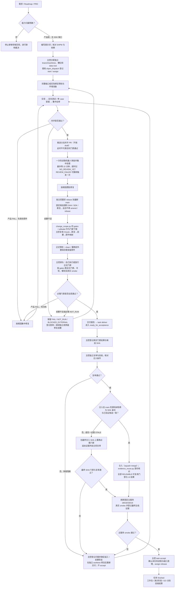
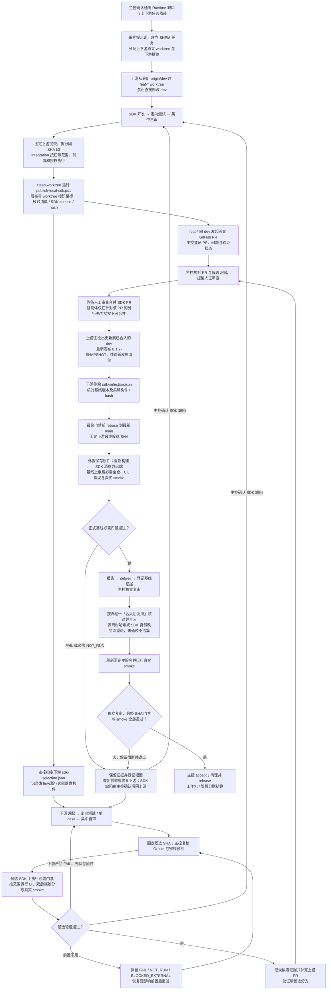

# 002 功能交付流程规范（纯产品与跨 SDK 协同）

| 项目 | 内容 |
| :--- | :--- |
| **文档编号** | 002 |
| **主题** | Super Harness 纯产品功能与跨 SDK 功能的交付顺序、门禁和结算条件 |
| **适用仓库** | `D:\workspace\haifa-agent-super-harness`、`D:\workspace\haifa-agent` |
| **更新日期** | 2026-10-06 |
| **依据规范** | [AGENTS.md](../../AGENTS.md)、[Runtime / Product Boundary](../runtime-product-boundary.md)、[SHPM 使用手册](../shpm-manual.md)，以及上游 `AGENTS.md`、`build-support/README.md` |

本文是操作索引；具体任务的 Oracle、必需门禁和人工验收要求以当前派单、Roadmap 35 / PRD 及上述规则为准。脚本建议、局部 PASS 和候选 SDK 证据不能自动提升任务、工作包或阶段为 `PASS` / `GO`。

## 0. 先判定能力归属

| 需求归属 | 处理方式 |
| --- | --- |
| DeerFlow REST/SSE/WS 兼容、UI/BFF、产品配置与业务集成、已有公开 Port 的 Workspace 窄适配 | 无需修改 SDK 时走流程一 |
| 通用 Run/Loop/Context/Memory/Tool/Skill/MCP/Sandbox/Artifact/Checkpoint/Permission/Multi-Agent Runtime 语义缺口 | 上游到 Haifa Agent，走流程二 |
| 归属不清，或领域复杂度必须超过冻结 DeerFlow 对应实现 | 在新增领域对象、状态机或持久化表之前停止，按架构护栏提交设计说明，由主控评审并等待所需人工裁决 |

- 冻结来源为 `bytedance/deer-flow@e545c28ac301e6f9feae247c513d8ea8f83df294`；直接复用冻结前端，不另造 UI 或回落 DeerFlow 后端。
- Super Harness 只通过公开 API/SPI 和本地 Maven 仓库的公开 JAR/BOM 消费 SDK，不实现第二套 Agent Runtime。
- 提示词放在 `private-docs/prompts/39-deerflow-parity-delivery/` 对应工作包目录；交付报告放在 `private-docs/ai-coding-report/` 指定位置；原始日志、trace 和截图放在本工作包外置证据目录。
- 各执行 worktree 将[验收短交接](../acceptance-handoff-template.md)维护在 `local-tmp/acceptance-handoff.md`，事实变化时更新。SHPM 是任务状态的唯一账本，只有主控执行 SHPM 写入。

## 1. 流程一：纯 Super Harness 产品交付

适用于无需修改上游 SDK 的产品功能，默认消费已发布的 `0.1.2-SNAPSHOT` 基线。

### 1.1 流程图



### 1.2 开发与正式验收

1. **派工与资源**：先确认任务依赖、独立 branch/worktree、基线 SHA、完整槽位端口和独立 `data-root`。子智能体槽位共四个：槽位 1 `20618/25618`、槽位 2 `30618/35618`、槽位 3 `40618/45618`、槽位 4 `11618/16618`，同一时刻每槽仅一任务。开发服务不占用主端口 `18018/33018`。启动前检查动态/排除端口范围，并对完整端口组实际绑定预检；不能只查监听表。
2. **内环**：执行者实现后运行受影响定向测试和必要的单 case UI，集中自审、按根因攒批修复，再进入稳定候选正式门禁。UI spec/fixture 变更先用 `-CaseTitle '<完整标题>'` 跑受影响 case。局部结果和 `-PreflightOnly` 不代替全套验收。commit/push 前只要求范围内定向测试、`git diff --check`、secret scan 和 SDK 基线检查。
3. **候选 SHA 与正式门禁**：机器人审查意见处理完后，按主控要求 rebase 到最新 `main`，固定候选 SHA、SDK 构件和断言；候选固定后不再 amend/rebase，除非主控明确要求。全仓门禁、正式 UI 轮次和慢测试是正式门禁，由主控排队：主控自己执行，或明确放行后由执行者在自己的槽位执行；未运行的记 `NOT_RUN`。门禁和真实 smoke 须在报告可合并前完成。源码、SDK 构件或断言改变后，重跑受影响门禁，不沿用失效 PASS；交付证据须绑定最终候选提交，不能用 dirty 状态的结果证明最终 SHA。
4. **PR 与机器人审查**：内环稳定后先把分支推送到远端并开 PR。PR 以可审查状态打开，不用 draft：机器人只在 PR 打开、draft 转 ready 或评论 `@codex review` 时审查。此时的 PR 不代表任何门禁通过，PR 描述须写明正式门禁尚未运行。结论为 `REVIEW_FAILED` 时可以评论一次 `@codex review` 重新触发，仍然失败就如实记录并继续。开 PR 后最多等机器人审查 10 分钟，超时按 `NO_REVIEW_YET` 记录并继续，不无界等待。审查意见只处理一轮：正确的采纳，不采纳的各写一句理由，不再主动请求重新审查。按根因攒批修复后固定候选提交，再进入正式门禁；正式门禁通过后才出现的新意见，只有确认会导致错误行为时才修改并重跑受影响门禁，其余登记为后续事项。向人工报告 PR 可合并之前，必须运行 `scripts/governance/pr_review_digest.py` 并给出结论。
5. **Oracle 与预检**：昂贵全仓构建或双后端 UI 之前，列出 `Oracle case → 实际断言 → 必需前置条件 → 预期原始证据`，由主控复核关键正反例。正式 UI 一次性核对冻结来源、SDK 实际落盘构件、前端依赖与浏览器、完整端口组、独立数据/凭据、Provider、Gateway 和前端代理目标。已存在资源的跨身份拒绝不能由不存在资源的 404 替代。
6. **原件与失败**：任何 `mvn clean` 或重跑之前，将需保留的 trace、截图及前后端/Provider 原始日志复制到该工作包外置证据目录，记录原路径和复制路径。首次 FAIL 永久保留；`NOT_RUN` 写明缺失前置。前置失效只停止受影响批次，独立用例继续；批次内不边测边改产品，结束后归并根因修复。不得放宽断言或缩改 Oracle 换取绿灯；确需裁剪某条 Oracle 时，须经人工逐项批准并在 SHPM 登记为已知差异。

门禁范围以 `python scripts/governance/change_scope.py` 输出的 `gates` 和 `uiModel` 为准，混合改动由脚本取并集；改动路径到门禁的分类表只在该脚本里维护，本文不再抄写。输出是下限，须对照任务 Oracle 复核，主控或复审可以要求更多。`gates` 里各项的含义：

| `gates` 项 | 含义 |
| --- | --- |
| `docs-check` | 文档检查 |
| `script-regressions` | `scripts/verify-scripts.ps1` 脚本回归 |
| `verify-full` | Java 输入指纹已变，全仓门禁须真跑 |
| `verify-full-reuse` | Java 输入指纹未变，只需存在同指纹的真实通过摘要；`verify-full.ps1` 自动复用并注明来源，没有时真跑一次 |
| `ui-cold-round` | 冷轮，单独启动 |
| `ui-<model>-round-x2` | 同一提交上两次暖轮，用同脚本重复运行区分稳定问题与偶发问题 |
| `ui-<model>-round-x1` | 一轮暖轮，通过即可；失败须先用同一脚本重跑一次再定位 |

`<model>` 为 `live` 时使用真实模型，仅当改动全部落在脚本的受控表内时为 `controlled`（脚本内分别称 Rule B、Rule D）。除 `gates` 含 `ui-cold-round` 外，冷轮也在前端依赖、槽位、代理目标变化或构建戳失效时执行；新 worktree 无构建戳时首轮自然为冷轮。同一提交上的重复运行可以在一次启动内完成（`-Passes 2 -SkipBuild`），仅限 runner 里已验证可重复的 profile。局部冒烟及另一 SHA 的结果不能替代必需轮次。

每轮报告准备/构建、就绪、断言、归档、复审及返工耗时，启动与总耗时、重试、首个超时/卡点、Next 动态编译时间、trace/截图/日志位置及端口/子进程清理结果。等待必须有对象、deadline 和超时证据；重型构建、UI 与共享 Provider 由主控排队。

真实 smoke 的断言和必需 Run/Tool/Artifact/Approval 证据按任务范围确定。需要访问真实 Provider 时先确认当前任务的授权与凭据；未授权或前置不足如实记 `NOT_RUN`，不私自运行，也不以本地 fixture 替代真实模型门禁。

### 1.3 合入、复用与 SHPM 结算

- **合入后复用**：合入方式不限（本仓库 PR 一律 squash merge）；合入后 `main` 的源码树哈希和 SDK 身份与已验证候选相同即可复用，用 `python scripts/governance/evidence_reuse.py --target <合入后提交> <证据>` 逐份核对，全部 `REUSABLE` 才复用，`STALE` 一律在合入后的提交上重跑。全仓门禁用 Java 输入指纹判定，脚本回归摘要和 UI 证据用 `sourceTree` + `sdkIdentity` + `sourceDirty=false` 判定；缺字段的旧证据记为 `STALE`。若相应门禁按范围不适用，应在交接中写明依据。客户演示“同一主线 SHA 连续两轮 L3”不受此裁剪影响。
- **构建复用**：后端比较 Java 输入指纹（排除 `docs/`、`tests/`、`scripts/`、根目录 `*.md` 后的源码树，加每个 Haifa JAR 的 SHA-256 身份及 JDK/Maven 版本），前端检查冻结源码树、lockfile、代理目标和构建 profile。复用产物不复用 Run、Thread 或数据目录；测试结果能否复用只按上一条和全仓门禁的指纹复用判断。SDK 同版本重新发布后的重建见 §2.2。
- **状态链**：主控按 `start / assign → checkpoint → deliver → verify → 独立验收 → accept / release` 推进。`deliver` 只进入 `ready_for_acceptance`；`accept` 需要独立复审、已合入及最终主线 SHA 证据，之后确认本任务端口和子进程清理并释放派工。复审失败保留必需 FAIL 和阻断 Issue，合法返工状态处理按 SHPM 手册执行，不虚假 accept。
- **分开结算**：单任务 finished 不等于工作包完成。全部任务及工作包退出条件满足后，主控再执行 `wp state ready_for_acceptance` / `wp complete`；演示阶段另查依赖、登记阶段验证与结果，`GO` 通过 `sprint decide` 设置，不自动关闭长期工作包。

## 2. 流程二：跨 Haifa Agent SDK 协同交付

本流程在流程一的资源、Oracle、证据和 SHPM 规则之上增加上游开发、候选 SDK 消费及正式基线回归。

### 2.1 流程图



### 2.2 跨仓核心约束

1. **上游分支与验证**：在 `D:\workspace\haifa-agent` 从最新 `origin/dev` 创建 `feat-*` 分支，worktree 放在 `D:\workspace\haifa-agent-worktrees\`；不在 `dev` 上开发。先做受影响定向验证，再按上游规则完成同一 SHA 的 L3 `-Pci-fast clean verify`。Integration 必须有同 SHA Unit PASS，并核对测试配置、显式开关与当前任务授权；不能将任意 `ci-integration-only` 结果视为全部真实 Provider 用例通过。
2. **发布与来源**：只有 `scripts/publish-local-sdk.ps1` 可向本地 Maven 仓库发布 SDK；发布要求工作树 clean。特性 worktree 坐标为 `0.1.2-<worktree 目录名>-SNAPSHOT`，基线 `0.1.2-SNAPSHOT` 只由上游主检出的 `dev` 发布。按实际 `haifa-sdk-publish-manifest.json` 核对版本、`sdkCommit`、分支、worktree 和公开构件 hash/长度，并核对 BOM/POM；公开模块清单以发布脚本当前分类为准，不把历史构件数量当作永久常量。发布脚本跳过测试，其 SUCCESS 不替代同 SHA 测试门禁。
3. **下游选择**：由主控在已分配的下游 worktree 写入 `local-tmp/sdk-selection.json`，执行者不自行更换版本、不用修改 POM 或直接传 `-Dhaifa.version` 来选择候选 SDK。带标识版本不进入被跟踪文件；只能消费公开 JAR/BOM，不依赖 SDK 源码或产品 JAR。
4. **修改与重发布**：候选 SDK 的问题须由主控验收确认后再修改并重新发布。重发布时版本号可能不变，但服务端构建戳现含每个 Haifa JAR 的 SHA-256 身份，会识别同版本重发布的内容变化并使旧产物不可复用；先保留首次 FAIL，再重新构建消费方后端并重跑受影响门禁。
5. **人工 PR 卡点**：特性分支向 `dev` 发起英文 GitHub PR，由主控在 SHPM 登记 `verify` / `issue` 和关联状态，提醒人工审查合并。智能体不得自行合并，除非人工针对该具体 PR 另行书面授权。人工合并后，须将上游主检出更新到已合入的 `dev`，再重新发布基线，不能把远端 PR 已合并等同于本机基线已更新。
6. **基线正式回归**：下游删除 selection，核对新基线发布清单、SDK commit 和实际落盘构件，运行基线版本检查；最终门禁前 rebase 并固定下游 SHA。`verify-full.ps1` 的 `clean verify` 重新构建后端，然后在基线上重跑必需 UI、协议、双后端差分（若任务要求）及真实 smoke。候选 SDK 的 PASS 不替代基线回归；依赖尚未合入上游 `dev` 的分支不得合入下游 `main`。
7. **复用边界**：SDK 更新后构建戳因 JAR 身份变化而失效，消费方据此自动重建；带 `-SkipBuild` / `-SkipServerBuild` 强制复用时构建戳不符会直接失败。先通过 `verify-full.ps1` 重建后端，再让 UI runner 使用该新产物。无需清空 Maven 本地仓库，也不无条件清空前端缓存：冻结源码、lockfile、代理目标及 profile 未变且构建戳通过时，runner 可以自动复用前端产物。只改文档、脚本、测试或 UI 用例而不动 Java 输入的提交，Java 输入指纹不变，可复用已有 JAR。每轮仍使用独立数据与新证据。

## 3. 常用入口与命令模板

以下命令中的占位值须替换为本任务实际值；Super Harness 命令在下游仓库根运行，上游命令在 SDK worktree 根运行。SHPM 命令只由主控执行。

### 3.1 下游开发与验收

```powershell
python scripts/governance/change_scope.py
pwsh -NoProfile -File scripts/test-targeted.ps1 -Test '<受影响用例>' -LowMemory
pwsh -NoProfile -File tests/checks/build/verify-haifa-version-baseline.ps1
# 推送分支并开 PR（不用 draft）后一次性读取机器人审查（只读；退出码 0=CLEAN、2=FINDINGS、3=NO_REVIEW_YET、4=REVIEW_FAILED）。
python scripts/governance/pr_review_digest.py --repo <owner/name> --pr <编号>
# Oracle 和正式预检完成、原件外置后，按范围执行；不传 -Forks 时按空闲内存自动选 3 个进程或 1 个进程（1 个进程时自动低内存），
# 显式 -Forks / -LowMemory 行为不变。实测 2026-10-05（16 核 31 GB）：1 进程低内存约 811s、3 进程约 250–380s。
# 预检后若已有同 Java 输入指纹的真实 PASS 摘要则自动复用并在摘要写 reuse 来源；-NoReuse 强制真跑，
# -NoKnownIntermittent 关闭已登记偶发失败分支。
pwsh -NoProfile -File scripts/verify-full.ps1
# 合入后逐份核对旧证据：全部 REUSABLE 才复用，任一 STALE 在合入后的提交上重跑（退出码 0=全可复用、2=有 STALE）。
python scripts/governance/evidence_reuse.py --target <合入后提交> <证据文件或目录>...
# 示例为常规槽位 2；新槽位或构建戳失效时 runner 会构建，暖轮按构建戳规则复用。
pwsh -NoProfile -File scripts/ui/run-w18-ui-smoke.ps1 `
  -AgentSlot 2 -GatewayPort 30618 -FrontendPort 35618 `
  -SourceRepository 'D:\workspace\haifa-agent-super-harness\deer-flow'
```

单 case 在同一 UI 命令上添加 `-CaseTitle '<完整标题>'`；正式轮次去掉该筛选，按任务所需 profile 和完整用例执行。实际冻结 checkout 由主控指定，不能用默认 profile 的 PASS 代替专用 Oracle。

### 3.2 上游验证与发布

```powershell
# 固定同一 SHA 的上游最终 L3；Integration 另按上游 build-support/README.md 与任务前置执行。
pwsh -NoProfile -File build-support/scripts/invoke-haifa-maven.ps1 --layer L3 '--' `
  -Pci-fast clean verify
# 工作树 clean、测试门禁完成后发布；不以发布成功替代测试。
pwsh -NoProfile -File scripts/publish-local-sdk.ps1
gh pr create --base dev --title '<English title>' --body-file '<English PR description file>'
```

记录发布脚本返回的 `ManifestPath`、`SdkCommit`、`Version` 和实际构件清单；SDK 选择和构件核验入口见下游 [README「定向测试与 SDK 版本选择」](../../README.md#定向测试与-sdk-版本选择)。

### 3.3 SHPM 派工、交付与接受

主控先明确设置已有项目的 `SHPM_DB`，执行 `shpm doctor --json` 和 `shpm status --json`；非 HEALTHY 时停止写入。派工薄封装与结果薄封装不带 `--execute` 时只打印命令，确认参数与来源后再加该开关。

```powershell
python scripts/governance/shpm_dispatch.py `
  --task '<任务ID>' --wp '<工作包ID>' --title '<任务标题>' `
  --prompt 'private-docs/prompts/39-deerflow-parity-delivery/<工作包>/<工作包-任务名>.md' `
  --exit '<退出条件>' --executor codex --ref '<执行者引用>' `
  --branch 'codex/<任务分支>' --worktree '<独立worktree绝对路径>' `
  --slot 2 --data-root 'local-tmp/<任务>/data' --execute
# 仅任务服务于演示阶段时，派工命令增加 --stage '<SPRINT/STAGE>'。

$taskId='<任务ID>'
$assignmentId="asg-$taskId"
$operationKey='<本次操作的唯一键，重试沿用>'
shpm task deliver $taskId --assignment $assignmentId --commit '<候选SHA>' `
  --handoff '<private-docs/ai-coding-report/交付报告路径>' `
  --idempotency-key "$operationKey-deliver" --json

# 脚本回归用统一入口，摘要写 local-tmp/verify-scripts/。
pwsh -NoProfile -File scripts/verify-scripts.ps1
# 门禁结果从证据组目录递归登记（全仓摘要、脚本回归摘要、UI 证据目录、主服务刷新摘要）；
# 不带 --execute 只打印表，证据已归档时用 --raw-root 改写原件路径。
python scripts/governance/shpm_record_gates.py --task $taskId `
  'local-tmp/verify-full/<本轮摘要>.json' '<本轮UI证据目录>' --execute
# 只传实际存在且适用于本任务的输入；无 UI 门禁时省略 UI 路径。
# 薄封装覆盖不到的真实 smoke 及额外轮次，用 shpm verify add 逐项追加；不覆盖首次 FAIL。

# 主控独立复审、合入及最终 SHA / SDK / smoke 证据核对全部通过后：
shpm task accept $taskId --assignment $assignmentId --main-commit '<最终主线SHA>' `
  --idempotency-key "$operationKey-accept" --json
# 确认本任务端口和子进程已清理后：
shpm assign release $assignmentId --idempotency-key "$operationKey-release" --json
```

两套薄封装不会执行 `deliver`、`accept`、阶段结算或 `GO`。门禁登记脚本并不核准 SHA/SDK 是否可合入，仍由主控核对。`shpm_record_gates.py` 的幂等键为 `<任务>-<检查名>-<提交>-<证据身份>`，不含日期，同一份证据隔天重登仍幂等，不同轮次各自写入；写入前按时间稳定排序（UI 用已解析的开始时间，摘要用文件名时间戳，解析不出时间的排在最后并保持原顺序），使 SHPM 中同一检查名的最后一条记录是最新证据。UI 检查名带 profile，同一次调用里同 profile、同提交的多轮按开始时间追加 `-r1`/`-r2`；脚本回归清单外的检查文件使本次为 `FAIL_MANIFEST` 并记为 `FAIL`。结果原样登记（`FAIL` 和 `NOT_RUN` 都不提升），各轮保留原件、不覆盖首次 FAIL。状态变化后按规则执行 `tests/checks/evidence/verify-evidence-report.ps1`；整包、阶段与 `GO` 命令见 [SHPM 使用手册](../shpm-manual.md)。

## 4. 两套流程的准入条件

| 维度 | 纯产品交付 | 跨 SDK 协同交付 |
| --- | --- | --- |
| 工作空间 | 下游独立 branch/worktree、端口和数据目录 | 上下游独立特性 worktree；下游独立槽位和数据目录 |
| SDK | 已发布基线 | 研发期主控指定候选坐标；合入前切回重新发布的基线 |
| 最终门禁 | 最终 rebase 后的候选 SHA，按范围与 Oracle 执行 | 上游同 SHA 门禁及发布来源；下游正式基线上的最终候选门禁 |
| 合入前提 | 必需门禁与主控复审通过；最终源码状态与证据一致 | 另要求 SDK PR 已获授权合并入 dev，基线已发布，selection 已删除且基线回归通过 |
| 产物复用 | 后端按 Java 输入指纹（含 SDK JAR 身份）、前端按独立构建输入匹配；合入后按源码树哈希与 SDK 身份核对 | SDK 同版本重发布使构建戳失效，强制重建消费方后端；前端按独立输入校验 |
| 结算 | deliver → verify → 独立验收 → accept / release；工作包、阶段与 GO 分开 | 同左；候选 SDK 验证不等于正式基线交付 |
